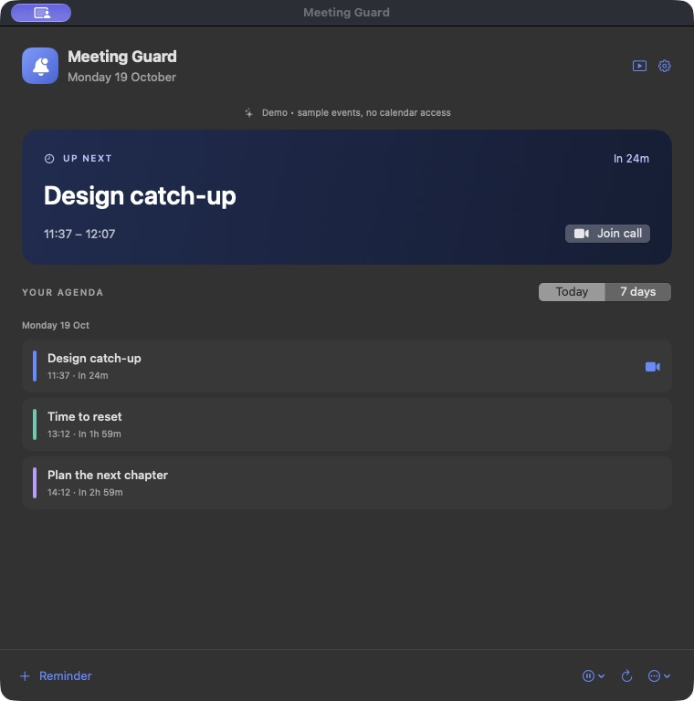
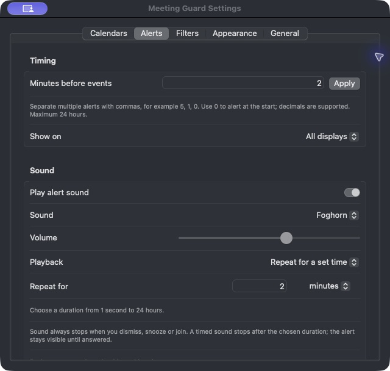

# Meeting Guard

Small meeting notifications are easy to miss on a large screen, especially when they appear outside your line of sight.

Meeting Guard shows a full-screen reminder and plays a loud, repeating alert. See it while you work, or hear it when you've stepped away to make tea or coffee.

- Show alerts on one display or all displays.
- Dismiss, snooze or join a meeting from the alert.
- Set several alert times for each event.
- Choose a sound and repeat it until answered or for a set time.
- Choose calendars, filter events and set working hours.
- Add personal reminders that repeat daily, on weekdays or weekly.

## Screenshots

| Agenda | Alert settings |
| --- | --- |
|  |  |

[View a full-screen meeting alert](docs/images/full-screen-alert.png). All screenshots use fictional events.

## Install from source

Meeting Guard runs on **macOS 14 or later**. There is no ready-to-install download yet.

1. Install [Xcode](https://developer.apple.com/xcode/) 16 or later. Choose a version [compatible with your macOS version](https://developer.apple.com/xcode/system-requirements). Open Xcode once and complete its setup.
2. Open Terminal and run these lines in order:

   ```sh
   git clone https://github.com/taylorwilliams/meeting-guard.git
   cd meeting-guard
   ./scripts/build-app.sh
   open dist
   ```

3. When the build finishes, Finder opens the `dist` folder. Drag **Meeting Guard.app** into **Applications**, then open it there.

If you are updating, quit Meeting Guard before replacing the app.

The build creates an app for your Mac's processor. You do not need a paid Apple developer account to build it for yourself. If the build fails, see [setup help](docs/SETUP.md).

## Set up

1. **Connect your calendars.** Click **Connect Calendars** and allow calendar access when macOS asks. In **Settings → Calendars**, leave the calendars you want switched on. Accounts must already appear in macOS Calendar. Use **Add accounts in macOS Settings…** if an account is missing.
2. **Choose when alerts appear.** Open **Settings → Alerts**, enter the minutes before each event and click **Apply**. For example, `5, 1, 0` gives alerts five minutes before, one minute before and at the start.
3. **Set the sound.** Choose a sound, volume and **Playback** option: **Play once**, **Repeat until answered** or **Repeat for a set time**. New settings use Foghorn for two minutes. Choose a volume you can hear when you step away from your desk. Dismissing, snoozing or joining stops the sound.
4. **Try an alert.** In the same tab, scroll down and click **Try a sample full-screen alert**. Press **Esc** or click **Dismiss** to close it.
5. **Start it at login.** In **Settings → General**, switch on **Launch Meeting Guard at login** if you want it to start automatically.

Keep the app running to receive alerts. Closing its window leaves it in the menu bar; quitting stops alerts. Your Mac must be awake.

For a reminder without a calendar event, click **+ Reminder** in the agenda. Calendar access is optional for personal reminders.

## Privacy

Calendar data stays on your Mac. Meeting Guard reads events without changing them. It has no accounts, analytics or servers. Clicking **Join** opens the meeting service.

Settings, personal reminders and snoozes are saved in `~/Library/Application Support/MeetingGuard/state.json` with owner-only permissions. The file is not separately encrypted. **Privacy mode** hides event titles, locations and notes in the agenda and alerts; management views still show saved reminder titles and calendar names.

## Contributing

Written in Swift and SwiftUI, with no third-party packages. Run `swift test` before submitting a pull request. See [contributing](CONTRIBUTING.md), [testing](docs/TESTING.md), [security](SECURITY.md) and the [release guide](docs/RELEASE.md).

Licensed under [MIT](LICENSE).
